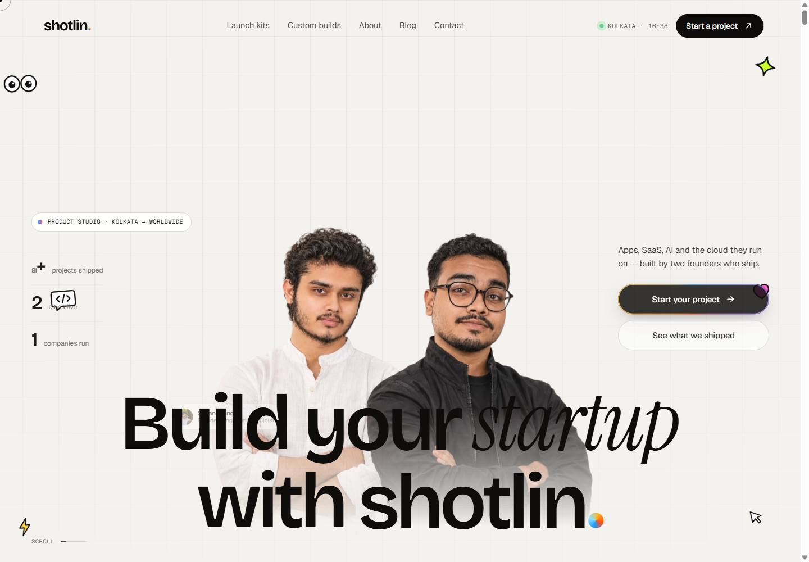

# Shotlin website

Shotlin's website presents its app development services, launch kits, founders, project work, and articles.



## Local development

Use Node.js 24 and npm.

```sh
cd web
npm ci
npm run dev
```

## Production build

```sh
cd web
npm run build
npm run preview -- --host 127.0.0.1
```

The build checks TypeScript and produces static pages in `web/dist`.

## Deployment

Deploy on Vercel with the repository root directory set to `web`, the Vite framework preset, `npm run build` as the build command, and `dist` as the output directory.

## Project structure

- `web/src`: TypeScript, styling, page behavior, GSAP animation, Lenis scrolling, and the project brief dialog.
- `web/partials`: Shared HTML fragments expanded by the Vite configuration.
- `web/public`: Images, self-hosted site assets, robots.txt, and sitemap.xml.
- `web/scripts`: Python utilities and templates used to author the existing HTML pages. Python is not needed for the npm build.
- `web/about`, `web/blog`, `web/contact`, `web/custom`, `web/launch-kits`, and policy folders: Individual HTML pages.

The site is a Vite multi-page application. Fonts are bundled through Fontsource. The project brief opens WhatsApp or the user's email app; it does not submit to a backend. External links include the founders' sites, project case studies, and Opslin. Canonical metadata and the sitemap currently use `https://shotlin.in`.

Local creative inputs, tools, dependency installations, credentials, and generated builds are excluded from Git. No reuse license is granted by this repository.
